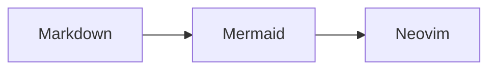

# Dotfiles

Personal configuration for Neovim, Git, tmux, and Ghostty.

## Prerequisites

* macOS (deps installer is macOS-only)
* Homebrew
* Git
* make

`make deps-install` installs mise via the official [mise.run installer](https://mise.jdx.dev/installing-mise.html) to `~/.local/bin/mise`. Other dependencies are installed via Homebrew, including Ghostty and the `MesloLGS Nerd Font` used by the default terminal config. See `scripts/install-deps.sh` for the full list.

## Setup

1. Clone the repository: `git clone git@github.com:radanisk/dotfiles.git`
2. Navigate to the repository: `cd dotfiles`
3. Install dependencies: `make deps-install`
4. Install Neovim config: `make nvim-install`
5. Install Git/tmux/Ghostty configs: `make dotfiles-install`
6. Activate mise in your shell as described below.

## Markdown diagrams

Neovim displays fenced `mermaid` blocks as inline images through `snacks.image`.
Use Ghostty (or Kitty); tmux passthrough is already enabled in this repository.
The Markdown Tree-sitter parser must be available (included with Neovim 0.12).

`make deps-install` installs ImageMagick and Mermaid CLI (`mmdc`). Install Google
Chrome in `/Applications`; Neovim configures Puppeteer to use it for rendering
diagrams. To use a different browser location, set `PUPPETEER_EXECUTABLE_PATH`
before starting Neovim.

After installing dependencies, restart Neovim and open a Markdown file containing:

````markdown

````

Run `:checkhealth snacks` if a diagram does not appear, and check that Google
Chrome is installed or `PUPPETEER_EXECUTABLE_PATH` points to a browser executable.

## mise

Re-running `make deps-install` lets the official installer keep an existing version when it is the same or newer, or update an older one.

This repository does not manage shell startup files. Add this line once to `${ZDOTDIR:-$HOME}/.zshrc`, replacing any existing mise activation:

```sh
eval "$(~/.local/bin/mise activate zsh)"
```

Open a new terminal, then check `command -v mise` and `mise doctor`. Using the explicit executable path for activation works even before `~/.local/bin` is on `PATH`; activation adds it. For other shells, see the [mise shell setup documentation](https://mise.jdx.dev/shell-setup.html).

## Update

Run `make update` to update mise via `~/.local/bin/mise self-update --yes`,
Homebrew packages/casks, tmux plugins (TPM), and Neovim plugins (Lazy).

## Local Git config

This repo keeps personal Git identity out of the shared `gitconfig`. Create a local override at `~/.gitconfig.local` with your name and email. The template contains commented placeholders, so you must edit it before your first commit.

```
cp files/gitconfig.local.example ~/.gitconfig.local
```

`make dotfiles-install` will create `~/.gitconfig.local` from the template if it does not exist.
